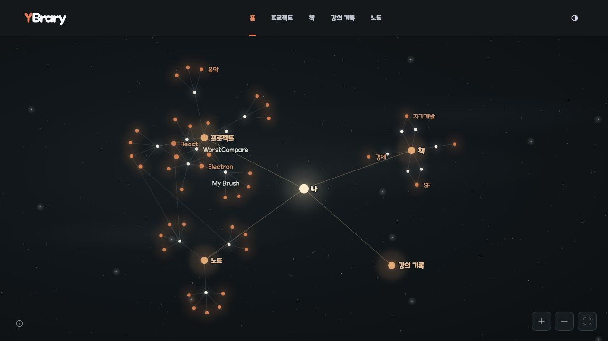
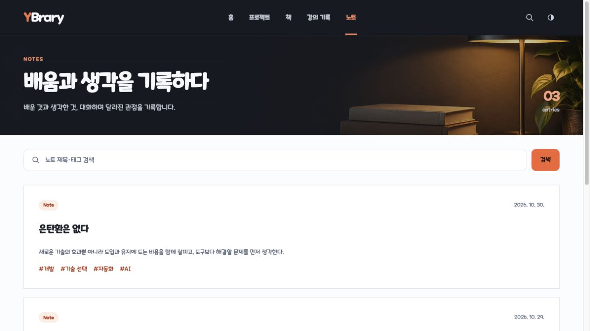

# YBrary

프로젝트와 책, 강의 기록, 노트를 한곳에 모은 개인 아카이브입니다. 만들고 경험한 것과 배운 내용을 기록하고, 주제별 연결을 따라 탐색할 수 있습니다.

## 화면 미리보기

### 그래프 홈



### 프로젝트 목록


### 노트 목록



## 주요 기능

- **그래프 홈**: 중앙의 ‘나’를 중심으로 프로젝트·책·강의·노트와 실제 태그 및 카테고리의 연결을 보여줍니다. 분류나 주제를 선택해 관련 기록을 살펴보고 상세 화면으로 이동할 수 있습니다. 드래그, 확대·축소, 키보드와 터치 조작을 지원합니다.
- **프로젝트**: 프로젝트 소개와 태그, 진행 기간, 이미지, GitHub 및 서비스 링크를 기록합니다. 제목·태그 검색과 태그 필터를 제공합니다.
- **책**: 독서 기간과 읽은 곳, 별점과 감상을 기록합니다. 제목·저자 검색과 카테고리 필터로 책을 찾을 수 있습니다.
- **강의 기록**: 강사와 플랫폼, 수강일, 별점과 후기를 기록하고 제목으로 검색합니다.
- **노트**: 배운 내용과 개인적인 생각을 Markdown으로 정리하고 제목·태그로 검색합니다.
- **반응형 화면과 테마**: 모바일 메뉴와 라이트·다크 테마를 지원합니다. 그래프 홈은 어두운 배경으로 표시합니다.

각 기록의 상세 본문은 Markdown으로 작성하며 표, 체크리스트, 코드 블록 등을 지원합니다. 프로젝트 이미지와 책 표지는 상세 화면에서 크게 볼 수 있습니다.

## 기술 구성

- React 19, TypeScript, Vite 기반 정적 SPA
- React Router, Tailwind CSS 4
- 정적 TypeScript 데이터와 Markdown, Zod 콘텐츠 검증
- Vitest, ESLint, TypeScript

## 시작하기

Node.js 24와 pnpm 11을 사용합니다.

```bash
corepack enable
pnpm install
pnpm dev
```

브라우저에서 `http://localhost:3001`을 엽니다.

## 콘텐츠 관리

- 프로젝트·책·강의 기록: `src/lib/content/static-data.ts`
- 노트: `content/notes/*.md`의 YAML frontmatter와 Markdown 본문
- 이미지: `public/` 아래의 정적 자산

콘텐츠는 빌드에 포함되며 Zod 스키마로 검증합니다. 상세 본문에 Markdown을 사용할 수 있고 HTML 태그는 표시하지 않습니다. 이미지에는 대체 텍스트를 작성하며 공개 전에 사용 권한을 확인합니다. 콘텐츠 항목과 화면 구성의 자세한 기준은 [제품 명세](docs/product-spec.md)를 참고하세요.

## 주요 명령

```bash
pnpm lint       # 린트
pnpm typecheck  # 타입 검사
pnpm test       # 테스트
pnpm build      # 정적 사이트 빌드
pnpm preview    # 빌드 결과 미리보기
```

## 빌드와 배포

`pnpm build`는 `dist/`에 정적 파일을 생성합니다. 목록과 등록된 상세 경로에 HTML 셸을 생성해 직접 접근과 새로고침을 지원합니다. 상세 본문은 브라우저에서 렌더링됩니다.

| 환경 변수 | 용도 | 기본값 |
| --- | --- | --- |
| `VITE_SITE_URL` | 메타데이터와 공유 링크의 기준 URL | `http://localhost:3001` |
| `VITE_BASE_PATH` | 앱과 자산의 기준 경로 | `/` |
| `VITE_ENABLE_INDEXING` | `true`일 때 검색 엔진 색인 허용 | `false` |
| `VITE_GA_MEASUREMENT_ID` | GA4 웹 스트림의 `G-…` 측정 ID. 미설정 시 방문 통계 비활성 | 없음 |

GitHub Pages 워크플로는 `main`에 push하거나 수동 실행하면 린트·타입 검사·테스트 후 사이트를 빌드하고 배포합니다. 워크플로의 기준 경로는 `/y-brary/`입니다.

## 방문 통계 설정

GA4는 운영 빌드에서만 사용합니다. `VITE_SITE_URL`의 HTTPS origin과 `VITE_BASE_PATH`의 운영 경로가 접속 주소와 일치하고 유효한 측정 ID가 있을 때 수집합니다. 개발 서버와 다른 주소의 미리보기에서는 수집하지 않습니다.

직접 보내는 이벤트는 첫 진입·실제 경로 변경의 `page_view`와 프로젝트 상세의 GitHub·사이트 링크 `click`입니다. 검색·필터 변경은 페이지 조회로 세지 않으며 페이지·이전 페이지·링크 URL의 query와 hash를 전송하지 않습니다. GA의 기본 `first_visit`, `session_start`, `user_engagement`와 기기 정보·쿠키 기반 식별은 사용됩니다. Google 신호와 광고 개인화는 코드에서 끕니다. 방문자용 설명은 [방문 통계 안내](public/notices/analytics.html)에 있습니다.

다음 GA 설정을 마친 뒤에만 측정 ID를 등록합니다.

1. [Google Analytics 설정 안내](https://support.google.com/analytics/answer/9304153?hl=ko)에 따라 `YBrary` 속성을 만들고 보고 시간대를 대한민국, 통화를 KRW로 설정합니다. 웹 스트림 주소는 `https://didxodnr0769-bom.github.io/y-brary/`를 사용하며 스트림 세부정보의 `G-…` 측정 ID를 복사합니다.
2. 관리 → 데이터 수집 및 수정 → 데이터 스트림 → YBrary 웹 스트림에서 **향상된 측정 전체를 OFF**로 설정합니다. 코드의 `send_page_view: false`만으로는 브라우저 기록 기반 자동 조회가 꺼지지 않으므로 이 설정이 필수입니다. [페이지 조회 설정](https://developers.google.com/analytics/devguides/collection/ga4/views)을 참고하세요.
3. 관리 → 데이터 수집에서 Google 신호 데이터 수집과 광고 개인화 허용을 끕니다. 보조 보호가 필요하면 웹 스트림 → 이벤트 → 데이터 수정에서 이메일 삭제를 켜고 `q`, `query`, `search`, `search_term`, `tag`, `category`, `kind`의 URL 매개변수 삭제를 설정합니다. [데이터 수정 안내](https://support.google.com/analytics/answer/13544947?hl=ko)를 참고하세요.
4. GitHub 저장소 Settings → Secrets and variables → Actions → Variables에 `VITE_GA_MEASUREMENT_ID`를 등록합니다. 값은 빌드 시 주입되므로 등록·변경 후 다시 빌드하고 배포합니다. 측정 ID는 브라우저에 공개되는 식별자입니다.
5. 운영 사이트에서 첫 진입·화면 이동과 프로젝트 외부 링크 클릭을 수행하고 GA 실시간 보고서에서 확인합니다. 검색·필터만 바꿀 때 조회가 늘지 않는지, 브라우저 네트워크의 GA 요청에서 페이지·이전 페이지·링크 URL에 query와 hash가 없는지도 확인합니다.

본인 방문을 제외하려면 같은 브라우저에서 `https://didxodnr0769-bom.github.io/y-brary/?analytics=off`를 엽니다. `localStorage`의 `ybrary.analytics.disabled=1`로 제외가 유지되며 `?analytics=on`으로 복원합니다. 다른 브라우저에는 각각 적용해야 하고 스토리지가 차단되면 현재 페이지에서만 제외될 수 있습니다.

## 서체 저작권

이 사이트에는 넥슨이 제공한 메이플스토리 서체가 적용되어 있습니다. 서체의 모든 권리는 ㈜넥슨코리아에 있습니다.

- [포함된 서체 저작권 안내](public/notices/maplestory-font.txt)
- [메이플스토리 공식 서체 배포 페이지](https://maplestory.nexon.com/Media/Font)
